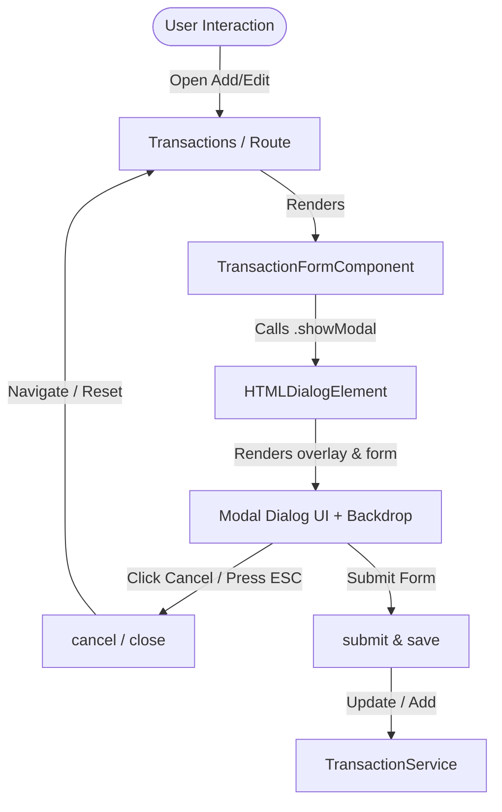

# Requirements

### Overview & Goals
Convert the transaction form component into a native HTML `<dialog>` modal. This enhances user experience by presenting the transaction creation and editing flow as a focused overlay modal with native accessibility and backdrop support.

### Scope
- **In Scope:**
  - Using `<dialog class="form-card">` in `TransactionFormComponent` template.
  - Controlling the dialog lifecycle (opening as modal via `showModal()`, closing on submit/cancel).
  - Handling user dismissals (ESC key, clicking cancel / close buttons, or backdrop interaction).
  - Styling the dialog and `::backdrop` pseudo-element for consistent look & feel in both light and dark themes.
  - Updating component unit tests to validate dialog interactions and lifecycle methods.
- **Out of Scope:**
  - Changing transaction data structures or backend API endpoints.
  - Modifying unrelated pages (e.g., Budgets, Settings, Dashboard).

### User Stories
- As a user, I want the transaction form to appear as a focused modal dialog so that I can add or edit transactions without losing context of the transactions page.
- As a user, I want to be able to close the dialog using the close button, cancel button, or pressing the Escape key.

### Functional Requirements
- **Native `<dialog>` Integration**: The form template uses `<dialog class="form-card">` and is opened modally using `HTMLDialogElement.prototype.showModal()`.
- **Modal Close / Dismiss**: Clicking the top-right `✕` button, the `Cancel` button, or pressing Escape properly closes the dialog, resets form state, and returns navigation to `/transactions`.
- **Form Submission**: Submitting a valid form saves the transaction (via `TransactionService.add` or `TransactionService.update`) and closes the dialog.

### Non-Functional Requirements
- **Accessibility**: Native dialog keyboard focus trapping and standard Escape key dismiss handling.
- **Cross-Theme Support**: Dialog and backdrop styling must adapt to light and dark themes via CSS variables.

# Technical Design

### Current Implementation
- `TransactionFormComponent` template was updated with `<dialog class="form-card">` at the root.
- The component currently handles form controls (`type`, `amount`, `merchant`, `category`, `date`, `notes`), submission to `TransactionService`, and route-based cancel navigation.
- Browsers require calling `.showModal()` on standard `<dialog>` elements to display them as top-layer modals with backdrop support.

### Key Decisions
- **Native HTML `<dialog>` vs Custom Modal Wrapper**: Use the native `<dialog>` element to leverage built-in browser modal capabilities (top layer, backdrop pseudo-element, Esc key dismiss, and focus management) rather than custom overlay divs.
- **Component Lifecycle Integration**: Access the native dialog element via `@ViewChild('dialog')` or `ElementRef<HTMLDialogElement>` and invoke `showModal()` in `ngAfterViewInit` / `ngOnInit` when displaying the form.
- **Global & Dialog Backdrop Styling**: Define `dialog.form-card` and `dialog::backdrop` rules in `src/styles.scss` to guarantee visual consistency with existing form styles.

### Proposed Changes
1. **`TransactionFormComponent` (`src/app/components/transaction-form/transaction-form.component.ts`)**:
   - Add template reference `#dialog` to `<dialog class="form-card">`.
   - Inject / query `ElementRef<HTMLDialogElement>` via `@ViewChild('dialog')`.
   - Call `dialog.nativeElement.showModal()` on view initialization.
   - Attach listener for the dialog's `cancel` / `close` event to invoke `cancel()`.
   - Call `dialog.nativeElement.close()` in `cancel()` and after successful `submit()`.
2. **Global Styles (`src/styles.scss`)**:
   - Add styling rules for `dialog.form-card` (reset margin, default border, padding, and positioning).
   - Add styling rules for `dialog.form-card::backdrop` with dark transparent overlay (`rgba(0, 0, 0, 0.45)`) and subtle blur.
3. **Unit Tests (`src/app/components/transaction-form/transaction-form.component.spec.ts`)**:
   - Provide polyfills/spies for `HTMLDialogElement.prototype.showModal` and `HTMLDialogElement.prototype.close` during Karma test runs.
   - Verify that `showModal()` is called and closing actions dismiss the dialog.

### Architecture Diagram

### Components
- **`TransactionFormComponent`** (`src/app/components/transaction-form/transaction-form.component.ts`): Houses the reactive form and dialog control logic.
- **`TransactionForm Template`** (`src/app/components/transaction-form/transaction-form.component.html`): Declares `<dialog #dialog class="form-card">` with modal header, form controls, and action buttons.
- **`Global Styles`** (`src/styles.scss`): Provides dialog and `::backdrop` styling.

### File Structure
- `src/app/components/transaction-form/transaction-form.component.ts` (Modified)
- `src/app/components/transaction-form/transaction-form.component.html` (Modified)
- `src/app/components/transaction-form/transaction-form.component.spec.ts` (Modified)
- `src/styles.scss` (Modified)

# Testing

### Validation Approach
Automated Karma unit testing and build verification will validate the `<dialog>` modal behavior, form submissions, and cancellation flows.

### Key Scenarios
- **Dialog Modal Display**: When `TransactionFormComponent` initializes, `showModal()` is called on the dialog element to show the modal overlay.
- **Cancel / Close Action**: Clicking the `✕` close button or `Cancel` button calls `close()`, resets the form, and triggers navigation.
- **Escape Key Dismiss**: Triggering the native `cancel` event on the dialog invokes `cancel()`.
- **Form Submission**: Submitting a valid form saves the transaction and dismisses the dialog.

### Test Changes
- Update `src/app/components/transaction-form/transaction-form.component.spec.ts`:
  - Polyfill / spy on `showModal` and `close` on `HTMLDialogElement.prototype` in test environment.
  - Add test: `should open modal on init`.
  - Add test: `should close dialog on cancel and submit`.
  - Ensure all existing 12+ tests pass with dialog changes.

# Delivery Steps

### ✓ Step 1: Implement HTML dialog lifecycle in TransactionFormComponent
`TransactionFormComponent` manages the native `<dialog>` element lifecycle using `showModal()` and `close()` methods with proper event binding.

- Query the `<dialog>` element reference in `TransactionFormComponent` via `@ViewChild` or `ElementRef<HTMLDialogElement>`.
- Open the dialog modal on component initialization / when triggered using `showModal()`.
- Handle dialog close and cancel events (including native ESC key press and backdrop clicks) to trigger `cancel()`.
- Ensure form resets and router navigation work seamlessly when closing or submitting the dialog.

### ✓ Step 2: Style dialog and backdrop in global stylesheet
Dialog styles in `src/styles.scss` render cleanly with centered positioning, rounded borders, and semi-transparent backdrop across light and dark themes.

- Add styles for `dialog.form-card` to override default browser dialog margins, paddings, and borders.
- Style `dialog::backdrop` with dark overlay (`rgba(0, 0, 0, 0.5)`) and smooth backdrop blur.
- Ensure dialog typography, colors, and border styling integrate with existing CSS custom properties (`--color-surface`, `--color-border`, `--color-text`).

### ✓ Step 3: Update and expand unit tests for dialog behavior
Unit tests in `transaction-form.component.spec.ts` verify dialog opening, closing, submission, and cancel behaviors without regressions.

- Update existing unit tests to mock or support `HTMLDialogElement.prototype.showModal` and `close` in the Karma test environment.
- Add test cases verifying `showModal()` is invoked and dialog closes on save or cancel.
- Run Karma test suite and Angular build to ensure zero regressions.